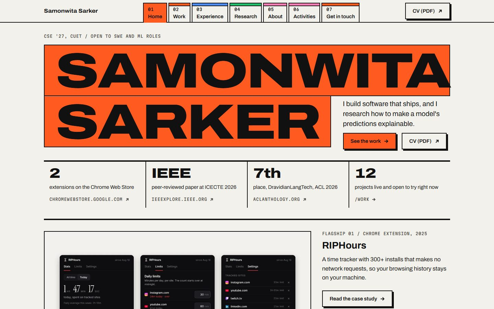
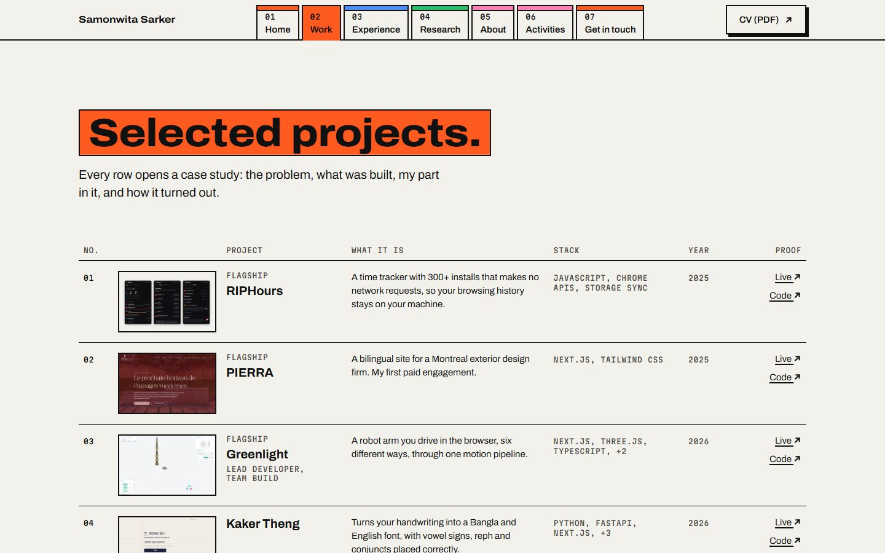
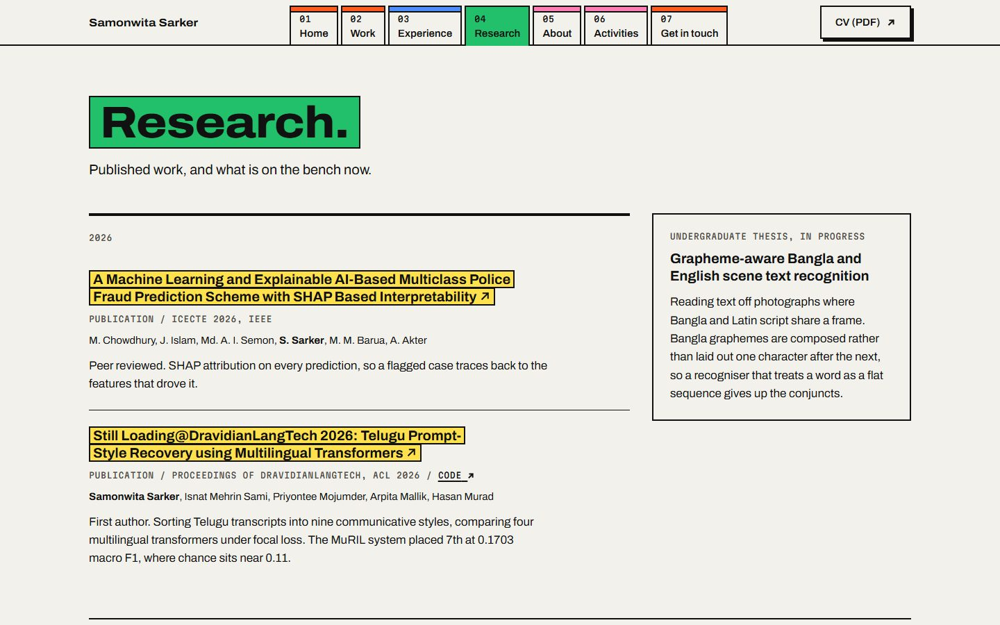
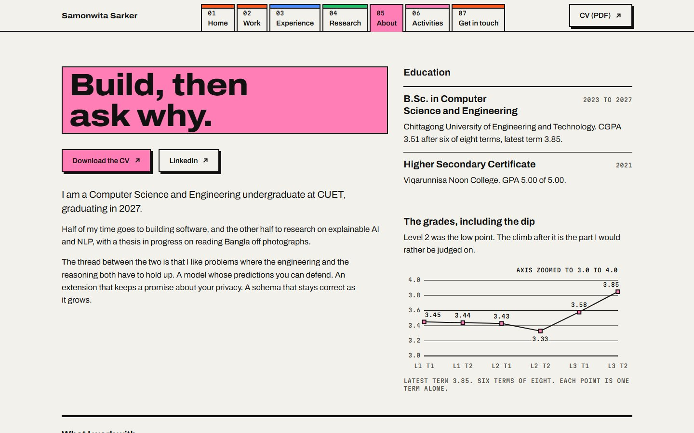
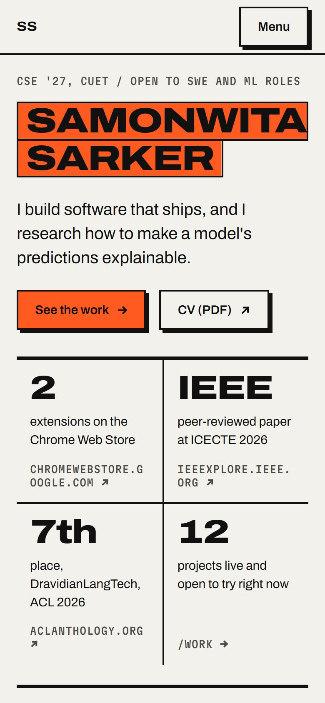
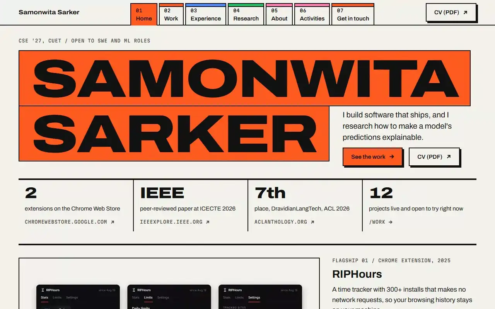
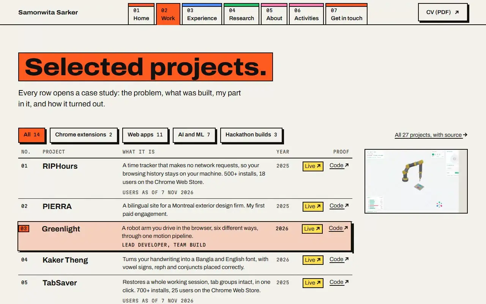

<p></p>

# Samonwita Sarker, portfolio

The personal site of Samonwita Sarker, a Computer Science and Engineering
undergraduate at CUET (class of 2027) who builds software and researches
explainable AI and NLP.

**Live:** [samonwitasarker.pages.dev](https://samonwitasarker.pages.dev)



<table>
  <tr>
    <td width="50%"></td>
    <td width="50%"></td>
  </tr>
  <tr>
    <td width="50%"></td>
    <td width="50%" align="center"></td>
  </tr>
</table>

---

## Contents

- [What the site is](#what-the-site-is)
- [Pages](#pages)
- [What it does well](#what-it-does-well)
- [Tech stack](#tech-stack)
- [Getting started](#getting-started)
- [Project structure](#project-structure)
- [Editing content](#editing-content)
- [Design system](#design-system)
- [How the build works](#how-the-build-works)
- [Things that are easy to break](#things-that-are-easy-to-break)
- [Deployment](#deployment)
- [Credits](#credits)

---

## What the site is

A portfolio built on one idea: **every claim carries its receipt.** Explainable
AI traces a prediction back to the features that caused it, and a debater backs
every point with evidence. The site does the same. Every project states the
problem, what was built and how it turned out, with a live link and the source
wherever they exist. Every figure in the strip under the hero links to the
thing that proves it: the Chrome Web Store listing, the IEEE paper, the ACL
Anthology page, the list of running projects.

Nothing is mocked up. Every project image is a capture of the real, running
product.

## Pages

| Route | What is on it |
|---|---|
| `/` | The name at poster scale, one line on what she does, four proof figures, and the three flagships as an index beside one exhibit frame that shows the row you point at |
| `/work` | One index table of every project, flagships first, each row opening its case study; filter chips by kind, and from 1024px a sticky frame showing the row you point at |
| `/work/<slug>` | A case study per project: problem, what was built, her part on team work, how it works, the result, with a sticky index of those sections from 1024px |
| `/experience` | Team lead at BdREN Innovation (Cortex), Fleet AI, Inc., and a freelance client site |
| `/research` | An IEEE ICECTE 2026 paper, a first-author ACL 2026 system paper, and the thesis in progress |
| `/about` | Introduction, education with the CGPA and a term-by-term trend chart, and the stack |
| `/activities` | Leadership roles, competitions and certificates |
| `/contact` | Email, profiles and a contact form |
| `/repositories` | Every project in one table with source and live links, including work on other people's repositories |

The seven in `ROUTES` are a reading sequence, numbered 01 to 07: the file tabs
in the header, the left and right arrow keys and the pager at the foot of each
page all walk them in that order. Case studies and `/repositories` are reached
by link and sit outside the sequence.

## What it does well

- **Proof on the first screen.** The name, the role line, the proof figures and
  the primary action are all visible without scrolling at 1280x720 and on a
  390x844 phone. Each page in the reading sequence is at most two screens
  long at 1280x800 and three on a 390x844 phone, measured by
  `scripts/measure-pages.mjs`; `/repositories` and the case studies, which
  have an index, are exempt.
- **Arrow-key navigation** between pages, with an instant swap and no
  transition to wait for.
- **It works without JavaScript.** Every route, every case study included, is
  prerendered to real HTML, so search engines, link previews, applicant
  tracking systems and scrapers all read the full text.
- **Real metadata per page.** Each route ships its own title, description,
  canonical link and Open Graph tags, plus a generated sitemap and a social
  card rendered from the site's own fonts and tokens.
- **Genuine 404s,** with a designed page and a real 404 status.
- **Accessible by default.** One `h1` per page, labelled controls, a skip link,
  a 3px focus ring, 44px touch targets on touch screens, text contrast of 7:1
  or better, the new page announced on every change, and nothing animating
  under `prefers-reduced-motion`.
- **Light on the network.** Two font files, 62kB together, plus a 4kB
  narrow cut of Martian Mono that only phones fetch, for the proof row's
  domain lines; responsive WebP
  screenshots at two sizes; no animation library and no icon library.
- **A skin that stays put.** A ban script fails the build on any gradient,
  blur, glass, rounded corner, banned typeface, em dash, stray hex colour, or
  section colour used as a text colour.
- **Honest about authorship.** Projects on repositories she does not own say so,
  with the owner's name and her role.

## Tech stack

| | |
|---|---|
| Framework | React 19, TypeScript 6, React Router 7 |
| Build | Vite 8, with a server-side render pass for prerendering |
| Styling | Tailwind CSS 3, its theme cut down to the design tokens, plus `src/index.css` |
| Fonts | Archivo (variable, weight and width) and Martian Mono, self-hosted and subset |
| Tooling | oxlint, the ban script, Playwright (screenshot and image scripts only) |
| Hosting | Cloudflare Pages |

There are no other runtime dependencies. The contact form posts to
[Static Forms](https://www.staticforms.dev), so there is no backend.

## Getting started

Requires Node.js 20.19 or later (or 22.12 or later), which Vite 8 needs.

```bash
npm install
npm run dev        # development server at http://localhost:5173
npm run build      # typecheck, build, server-render, and prerender every route into dist/
npm run preview    # serve the production build
npm run lint       # oxlint
npm run check:bans # fail on any banned style; also the first step of build
```

Maintenance scripts, run by hand when their inputs change:

```bash
node scripts/capture-shots.mjs     # re-capture project screenshots from the live sites
node scripts/optimise-shots.mjs    # rebuild the 1400px and 700px WebP variants

# Both take ids, for when only one site has changed:
node scripts/capture-shots.mjs sixpence
node scripts/optimise-shots.mjs sixpence
node scripts/make-og.mjs           # re-render og.png and apple-touch-icon.png
python scripts/subset-fonts.py ... # rebuild the two font files from the upstream TTFs
node scripts/showcase.mjs          # record the 2 minute showcase video (needs a running preview)
```

All of them need a Playwright browser: `npx playwright install chromium`.
`showcase.mjs` also needs `ffmpeg` on the PATH and `npm run preview` already
serving on port 4173. It writes `showcase/`, which is gitignored: an MP4 at
1920x1080, an SRT of the same captions, and the raw WebM. Captions are burned
into the frame as well, because most places a recruiter opens a video ignore a
subtitle track. Edit the `BEATS` array to change the script; each beat declares
its own screen time, so the beats sum to the finished runtime.

## Project structure

```
src/
  pages/            One component per route, including CaseStudyPage
  components/       Page sections and shared pieces:
                      Header, Footer, Pager, Page, RouteEffects,
                      Hero, Proof, Flagships, Work, CaseStudy,
                      Experience, Research, About, Trajectory, Activities,
                      Entry, Contact, Repositories,
                      Exhibit (screenshot frames), ui (buttons, links,
                      proof marks, labels), Arrow
  data/content.ts   Every string a visitor reads
  data/shots.json   When and where each screenshot was captured
  lib/routes.ts     The reading order and each page's section colour
  lib/projects.ts   Project lists, flagships, case study paths, captions
  lib/transitions.ts, lib/TransitionRouter.tsx
                    Page changes through the View Transitions API
  lib/meta.ts       Title and description for every route
  lib/motion.ts     The motion layer's one script; its CSS is motion.css
  fonts/            woff2 files and their OFL licences
  index.css         The token file: colours, type scale, components
  motion.css        Every motion token and rule (see Motion)
  entry-server.tsx  The server entry used for prerendering
public/
  shots/            Project screenshots, each as original, 1400px WebP and 700px WebP
  og.png            Social card, generated by make-og.mjs; do not hand-edit
  favicon.svg, apple-touch-icon.png
  Samonwita_Sarker_CV.pdf  The CV, built from cv/
cv/                 LaTeX source for the CV
scripts/            prerender, check-bans, check-seo, check-dist,
                    measure-pages, capture-shots, optimise-shots, make-og,
                    make-banner, subset-fonts, showcase
docs/               Banner, screenshots and recordings for this README
```

## Editing content

**Almost everything lives in `src/data/content.ts`:** the profile, projects,
publications, experience, education, leadership, competitions and
certifications. Change it there and every page that shows it updates.

**Adding a project.** Add an entry to `featured` (the top of the `/work` index;
the first three are the flagship rows on the home page), `notable` (the rest of
the index) or `otherWork` (named only on `/repositories`). Every project gets
a case study page at `/work/<slug>` automatically. Write it from the project's own README, not
from memory: every number on the site came from a real source. Set `role`. On
work done with other people set `team: true`, which makes the case study say
"What we built", and set `myPart` from her own commits on the repository, never
from a guess. `flow` draws a short "How it works" path in the case study. Then:

1. Add the live URL to `TARGETS` in `scripts/capture-shots.mjs`, then run it
   with that id: `node scripts/capture-shots.mjs <name>`. It records the date
   in `src/data/shots.json`, which the caption under the image reads.
2. Run `node scripts/optimise-shots.mjs <name>`. Pass the id here too, so the
   shots that were already optimised are not put through a second re-encode.
3. Point `shot` at `/shots/<name>.jpg`. Every shot is 16:10.
A project with no deployment gets no image rather than an invented one. It can
be run locally and captured, or carry real `figures` instead.

**Refreshing the Chrome Web Store figures.** RIPHours and TabSaver show two
numbers each, from `chromeStore` near the top of `src/data/content.ts`:
`installs` from the developer dashboard (Chrome Web Store, the item, Analytics,
Installs), and `users`, the number printed on the public listing, so a visitor
who follows the link finds it there. Update both and set `asOf` to the day you
read them; every sentence and the "Users as of" label read from that one place.
The CV states the same figures in `cv/Samonwita_Sarker_CV.tex` (the Chrome
Extensions entry), so change them there too and rebuild the PDF.

**Changing the name, standfirst, positioning line or proof figures?** Run
`scripts/make-og.mjs` afterwards, so the social card says the same thing.

**Updating the CV.** Edit `cv/Samonwita_Sarker_CV.tex`, then build it and copy
the PDF into `public/`:

```bash
pdflatex -output-directory=cv cv/Samonwita_Sarker_CV.tex
cp cv/Samonwita_Sarker_CV.pdf public/
```

It needs a TeX distribution with `mathpazo`, `lmodern`, `enumitem` and
`hyperref` (MiKTeX or TeX Live both work). Pages break only between entries, so
an entry never starts on one page and ends on the next. Keep the CV and
`content.ts` saying the same things.

**Adding a page.** Create the component in `src/pages`, add the route in
`src/App.tsx`, add a title and description to `ROUTE_META` in `src/lib/meta.ts`
(which also puts it in the sitemap and the prerender), and add it to `ROUTES` in
`src/lib/routes.ts` if it belongs in the tabs and the arrow-key sequence.

**Copy rules.** No em dashes or en dashes anywhere: write "2023 to 2027".
British spelling. Headings are short phrases ending in a full stop, with the
sentence underneath when one is needed. No hype words (the ban script lists
them), no "not X, it's Y", no exclamation marks. A heading or summary names
what was built, for whom, and one checkable fact. Keep descriptions in
`meta.ts` to 160 characters or fewer.

## Design system

The site is an evidence file: a flat paper ground, black ink, thick rules, one
orange action colour and a yellow proof mark. Everything below is enforced by
the token set in `src/index.css` and `tailwind.config.js`, which replaces
Tailwind's defaults rather than extending them, and by `scripts/check-bans.mjs`.

### Colour

A paper ground, ink, one proof yellow, and a colour per section of the site,
like the coloured dividers in a ring binder. Text is only ever `ink` or
`ink-2`; every other colour is only ever a fill, and every fill carries a 2px
ink border.

| Token | Hex | Job |
|---|---|---|
| `paper` | `#F3F1EC` | page ground, `theme-color` |
| `paper-2` | `#E6E3DB` | neutral placeholder, table header fill |
| `ink` | `#111111` | all text, borders and shadows, the footer ground |
| `ink-2` | `#4D4B45` | dates, captions, metadata |
| `proof` | `#FFE14D` | only behind a claim that links to its evidence, and text selection |
| `orange` / tint | `#FF5A1F` / `#F6D0BF` | Home, Work, case studies, Repositories, Contact, 404 |
| `blue` / tint | `#4C8DFF` / `#CEDBF0` | Experience |
| `green` / tint | `#22C06A` / `#C5E6CF` | Research |
| `pink` / tint | `#FF7EB6` / `#F6D8E0` | About, Activities |

The mapping lives beside `ROUTES` in `src/lib/routes.ts`. The page root
carries `data-section`, set during render so the prerendered HTML has it, and
CSS turns that into `--section` and `--section-tint`. Components read only
those two: the H1 band, the primary button, the chart points, the active tab
and the read-progress bar take `--section`; hovered rows take `--section-tint`.
Every nav tab shows a 6px strip of its own section's colour.

The rules, also at the top of `src/index.css`: a section colour means where
you are and nothing else; one section colour per screen apart from the tab
strips; no opacity on a token, no gradients, no purple or violet, no new
shades. Ink on every fill is 5.90:1 or better and on every tint 13.21:1 or
better. `ink-2` is under 7:1 on `paper-2` and on the tints, so it is never set
there: a hovered row turns its `ink-2` text to ink.

### Type

Archivo for everything you read, Martian Mono for labels. Eight steps, as the
`t-*` classes; Tailwind's `fontSize` is empty, so there is nothing else to use.

| Step | Settings | Use |
|---|---|---|
| `t-display` | Archivo 850, width 125, uppercase | the name, the 404 |
| `t-h1` | 800, width 112 | page headings |
| `t-h2` | 700, 28px | project, company and paper titles |
| `t-h3` | 700, 20px | subsection headings |
| `t-lead` | 400, 20px | hero line, page introductions |
| `t-body` | 400, 17px | running text, 68ch at most |
| `t-small` | 400 or 600, 15px | secondary copy, buttons |
| `t-label` | Martian Mono 500, 12px, uppercase | every small label, date, stack and caption |

Proof figures use the display settings at 2.5rem (`t-figure`). No italic.
Neither family has the north-east arrow, so all three arrows are one SVG
(`Arrow.tsx`): right stays on the site, north-east leaves it, left goes back.

### Surface

Square corners everywhere. Borders are 1px inside tables, 2px on every
component edge, 4px to open a section. The one shadow, a hard 4px ink offset,
goes only on things you can press, and anything without it cannot be pressed.
On hover it lifts 2px; on press it sinks into its own shadow. No gradients,
no blur, no glass, no opacity overlays.

### Motion

One layer, mechanical in character: things are stamped, slid, snapped into
place, drawn with a ruler or swept with a highlighter. Crisp starts, hard
stops, no springs, no bounce, and nothing loops. Each motion runs once, when
its element first enters the viewport, and then the page is still.

<table>
  <tr>
    <td width="33%"></td>
    <td width="33%"></td>
    <td width="33%"></td>
  </tr>
  <tr>
    <td>Home, first load</td>
    <td>Arrow paging</td>
    <td>Work row to case study</td>
  </tr>
</table>

**Tokens,** all in `src/motion.css` and nothing else used: 120ms for a snap
(stamps, presses), 200ms for a hover or state change, 320ms for something
arriving, 480ms for a rule or highlight being drawn, 600ms for the chart's
line. Two curves: `cubic-bezier(0.2, 0, 0, 1)` for everything that arrives,
and linear for everything that is drawn (rules, the chart's line, the flow's
connectors). A stamp is a single keyframe
from scale 1.06 to 1. Siblings stagger 40ms apart, six at most. Only
`transform`, `opacity`, `clip-path` and `background-size` move, and layout
never shifts (CLS 0).

| | Motion | Where |
| --- | --- | --- |
| A1 | Section rules draw left to right, at constant speed | every 4px rule |
| A2 | The band behind a heading wipes in; the text is there from the start | every `h1` band |
| A3 | Proof marks sweep in like a highlighter, in reading order | every claim with a receipt |
| A4 | The nav tabs drop into place, once per session | header |
| A5 | A paper cover slides off a screenshot once it has decoded | every exhibit |
| A6 | Labels and index numbers stamp | flagship labels, work rows |
| F1 | The proof row prints like a receipt: each cell's rules are drawn from the top, its figure stamps, its label and domain appear, the arrow nudges once; cells 60ms apart | Home |
| F2 | A ledger's row rules are drawn left to right one after another, each row's text revealed from the top as its rule finishes; dates stamp | Experience, Research, Activities, `/repositories`, `/work` |
| F3 | After an exhibit's cover slides off, its caption slides out from behind the frame's bottom edge | every exhibit |
| F4 | A screenshot opens full size in a sheet, growing out of its thumbnail; Escape, the backdrop or Close shut it | every exhibit |
| F5 | A pager button, pointed at or focused, fills with the destination page's colour from the edge its arrow points to | every pager |
| F6 | A case study's Role, Type and Status stamp in turn, then its Live and Code links | case studies |
| F7 | When a message has gone, a SENT stamp lands over the form, then the confirmation line | contact form |
| F8 | Choosing a filter cuts the rows that leave and slides the rest to their places (FLIP, 200ms) | `/work` |
| B1 | Buttons: hover on 200ms, press on 120ms | every pressable |
| B2 | Links thicken their underline, and the arrow nudges 4px its way | every text link |
| B3 | A work row's number takes the section colour with a stamp | `/work` |
| B4 | A tab lifts 3px on hover, pulled out of a file | header |
| B5 | Phone menu items drop in 40ms apart; closing is instant | phone menu |
| B6 | A field's border draws in on focus; an error drops in | contact form |
| C1 | The CGPA line draws in 600ms, each point stamps as it is reached, then its label | `/about` |
| E4 | Before that, the chart opens on its full 0 to 4.0 axis and rescales to 3.2 to 4.0 while its "Axis zoomed" note stamps in | `/about` |
| E2 | How it works builds in drafting order: connector lines, box outlines, labels | case studies |
| E3 | Then its numbers advance one step per tick, a stamp and a hard pause each | case studies |
| C3 | Entrances on a new page wait until the page transition has finished | everywhere |

**How it switches on.** Nothing is hidden in the HTML. Every starting state
hangs off `html.m-js`, which a one-line inline script in `index.html` adds
before the first paint, and only when the visitor has not asked for reduced
motion. So the prerendered page, a page with JavaScript off and reduced motion
all show the finished state. `src/lib/motion.ts` (1.1kB gzipped, the
inline switch 0.3kB, and no animation library; Inspect, F4, is another
1.0kB) then watches each
element with one `IntersectionObserver` and marks it `data-in` when it first
enters the viewport. If that script has
not run within 1.5s, the inline script takes `m-js` off again so nothing waits
on it, and when the script does arrive, whatever is already on screen is
marked finished rather than replayed. The inline script is allowed by its
sha256 in the CSP in `public/_headers`. Scroll-driven animations are not used:
they would undraw when the visitor scrolls back up.

Each motion has its own scope class (`m-a1` to `m-f7`) on the app's root in
`src/App.tsx`, so one can be switched off by deleting its name. In
development, `/motion-lab` shows every motion as a labelled specimen with a
replay button; production builds leave that page out.

**Page changes** go through the View Transitions API (`src/lib/transitions.ts`,
`src/lib/TransitionRouter.tsx`, rules at the end of `src/index.css`):

- Between pages in `ROUTES`, the new page slides over the old one as a sheet in
  240ms: from the right when it is later in the reading order, from the left
  when it is earlier, for links, arrow keys and browser back and forward
  alike. The old page does not move. The sheet's leading edge is a 4px strip
  of the destination's section colour, a 2px ink border and a hard 4px ink
  shadow. The header and footer stay put.
- The active tab's fill travels along the tab row to the new tab in the same
  240ms, as one shared element.
- From `/work` to a case study, the screenshot in the sticky frame grows into
  the case study's exhibit in 300ms, and shrinks back on the way out, when the
  row clicked is the one in the frame.
- Everything else is an instant swap. So is every page change where the API is
  missing or the visitor has asked for reduced motion.

A new navigation mid-transition skips the running one, so input is never
blocked and nothing queues. Scroll resets before the new page is drawn; focus
moves to its `h1` and its title is announced through one `aria-live` region.

## How the build works

`npm run build` runs four steps:

1. **Typecheck** with `tsc -b`.
2. **Client build** with Vite. The `site-url` plugin stamps the absolute origin
   into `index.html` and generates `robots.txt` and `sitemap.xml`; the
   `route-meta` plugin writes a real `index.html` for every route in
   `ROUTE_META`, each with its own title, description, canonical link and Open
   Graph tags.
3. **Server build** of `src/entry-server.tsx`.
4. **Prerender** with `scripts/prerender.mjs`, which renders each route with
   React's `renderToString` and writes the markup into that route's file.

React then takes over in the browser and navigation is client-side from there.

`App.tsx` is split so this can work: `AppShell` holds everything inside the
router, and runs under `BrowserRouter` in the browser and `StaticRouter` on
the server.

**Prerendering goes through React, not a headless browser,** on purpose. A
browser-based version worked locally and failed on deploy, because every build
then depended on downloading a browser binary.

**The origin** for every absolute URL (canonicals, Open Graph, the sitemap,
robots.txt, structured data, the contact form's return address) is the one
constant `SITE_URL` in `src/lib/site.ts`. A custom domain is that one line.

**Routes are flat files:** `/about` is `dist/about.html`, `/work/dimsum` is
`dist/work/dimsum.html`. Cloudflare Pages serves those at the slash-free
address with a 200; the build adds a 301 from each trailing-slash form.

**After the build,** `scripts/check-seo.mjs` reads the finished HTML and fails
on a missing or duplicate title or description, a description outside 120 to
160 characters, a page without exactly one `h1`, an `img` without `alt`, a
wrong canonical, missing social tags or card, unparseable JSON-LD, or a page
nothing links to.

## Things that are easy to break

Each of these was a real bug.

- **Nothing may start hidden without `html.m-js`.** Every starting state in
  `src/motion.css` is behind that class, which only the inline script adds.
  A rule that hides something without it ships invisible text to everyone
  without JavaScript and to every crawler.
- **The inline motion switch in `index.html` is allowed by its hash.** Change
  one byte of it and Cloudflare blocks it, unless the sha256 in
  `public/_headers` changes too. `check-dist.mjs` fails the build when they
  differ.
- **Anything that starts in a "not ready" state must render ready on the
  server.** `Exhibit` does, and the chart renders drawn; otherwise visitors
  without JavaScript see empty boxes forever.
- **Frames match the image's ratio.** Card height follows card width. A height
  cap on an image silently crops it.
- **A lazy image must never be clipped while it loads.** A lazy image clipped to
  nothing never intersects the viewport, so it never loads. `Exhibit` fades the
  image's opacity instead.
- **The hero's grid items need explicit start columns.** The heading spans
  both columns and passes its two lines down through subgrid; the lead sits in
  column 2 of the surname's row. An item with only a span is auto-placed
  around the overlap and the grid grows an extra column.
- **Groups in a view transition paint in document order.** Each tab's label has
  its own transition name so it paints above the moving tab fill; without
  that the fill passes over the text. A `mix-blend-mode` cannot fix it, because
  each group is isolated.
- **`vite preview` serves the home page's HTML for every route,** so a check
  with JavaScript off proves nothing there. Run those against `npm start`
  (server.mjs), which serves each route's own file and real 404s.
- **Sixpence, DimSum and Kaker Theng run on Render's free tier,** which
  answers 200 with its own "waking up" page while an instance starts.
  `capture-shots.mjs` waits that page out; a capture taken during it is a
  picture of Render.
- **Tailwind emits `.relative` after `.absolute`,** so an element with both is
  `relative`.
- **Chrome does not reliably repaint a table row's background as it
  changes.** F2 draws a ledger's rules as a row background, so on the real
  table on `/repositories` (from 768px) the rows keep their own border and
  only their text moves.
- **Playwright's full-page screenshots can drop a layer that has animated.**
  To compare a page with its reduced-motion twin, capture it a screen at a
  time; `measure-pages.mjs` scrolls each page through before its full-page
  capture so every entrance has at least played.
- **The inline script in `index.html` also reads `/work`'s `?kind=` filter**
  and puts it on `<html data-kind>` before the first paint, so a shared
  filtered link never shows every row first. Its hash is in the CSP.
- **There is no catch-all rewrite,** deliberately. Every route is a real file, so
  Cloudflare Pages serves `404.html` with a real 404 for anything else. A
  rewrite would answer 200 for junk URLs.
- **`vercel.json` accepts only keys in Vercel's schema.** An unknown key fails
  the whole file, the same as a syntax error, and the old address would stop
  redirecting. Its `/` rule is separate because `/:path*` does not match the
  root.
- **Check layouts after any change** at 1920x1080, 1440x900, 1280x720, 1024,
  a 390px phone and a 320px one, where the display name is closest to the edge. Test against the built site: `vite preview`
  is fine for layout, but it falls back to the home page's metadata on every
  route, so check metadata against the files in `dist/` instead.

## Deployment

The site is hosted on Cloudflare Pages, project `samonwitasarker`. Pushing to
`main` builds and deploys it. `wrangler.toml` sets the output folder to
`dist/`; the build command (`npm run build`) is set in the Pages dashboard.
Pages serves only builds that exit 0, and `check-dist.mjs` makes sure a build
with template tokens or empty pages does not.

`public/_headers` sets the caching and security headers:

- Hashed files under `/assets/` are cached for a year and marked immutable.
- Screenshots and the social card keep stable filenames, so they are fresh for
  a day and served stale while revalidating for a week.
- The CV revalidates on every request, and the link the site renders carries a
  content hash as `?v=`, stamped in by `vite.config.ts`. The filename stays
  stable because it gets pasted into applications, but the token changes
  whenever the PDF does, so an updated CV can never be served from a cache.
- Every response carries `X-Content-Type-Options`, `Referrer-Policy`,
  `X-Frame-Options` and a Content-Security-Policy. The CSP allows the inline
  motion switch by its hash, Cloudflare Web Analytics, and Static Forms.
- Preview deployments (`<hash>.samonwitasarker.pages.dev`) carry
  `X-Robots-Tag: noindex`, so only production can be indexed.

Page views are counted by Cloudflare Web Analytics, switched on in the Pages
dashboard. Pages injects its script into every page at the edge, so it is not
in the repository; switching it on takes effect from the next deployment.

To deploy by hand:

```bash
npm run build
npx wrangler pages deploy dist --project-name samonwitasarker
```

**The old address,** `samonwita.vercel.app`, is a Vercel project kept only to
redirect: `vercel.json` answers every path with one 301 to the same path on
`samonwitasarker.pages.dev`, query string included, and sends the two old URLs
in `_redirects`, trailing-slash forms and `.html` addresses straight to their
final address so nothing chains. Pushing to `main` redeploys it too.

**`server.mjs`** is a local server, not a host. It serves `dist/` the way
Cloudflare Pages does: flat route files, the `_redirects` 301s and real 404s.
`scripts/measure-pages.mjs` (run in CI) starts it on a spare port, and
`npm start` runs it on port 10000 for checks with JavaScript off, which
`vite preview` cannot do.

After changing the social card, paste the URL into LinkedIn's Post
Inspector: LinkedIn caches the card on its first scrape.

## Credits

Designed and built by Samonwita Sarker.

Archivo and Martian Mono are used under the SIL Open Font License; the licence
files are in `src/fonts`. Project screenshots are of
Samonwita's own work and of team projects she contributed to, each credited on
the site.
